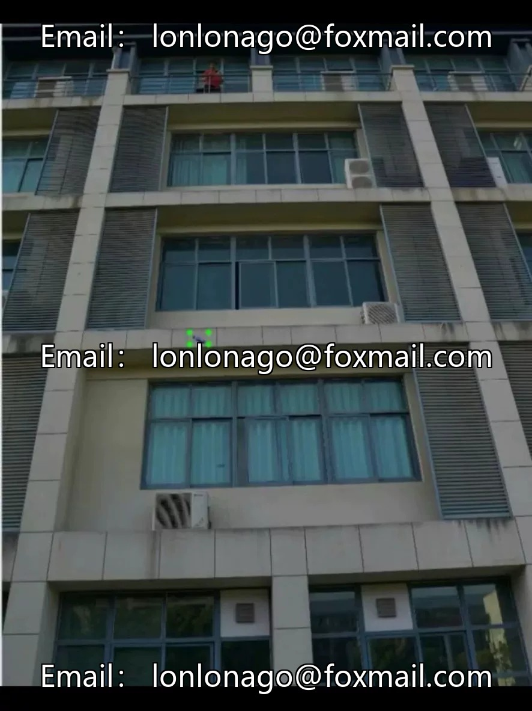

# High-altitude object throwing image recognition dataset (including model + interface)

## Body

High-altitude object throwing image recognition dataset (including model + interface)
The dataset consists of 696 images, including common objects such as water bottles, aluminum cans, garbage bags, trash bins, paper balls, paper cups, shopping bags, etc., with a total of 729 labeled boxes. Supports target detection tasks, YOLO format and VOC format have been labeled, with real-human annotations for quality assurance. The accompanying model weight files and graphical interface are ready-to-use, compatible with mainstream detection frameworks, suitable for community security monitoring, property management, smart city governance, and other scenarios.

Virtual materials, once sold, are non-refundable.
Interested friends, click "I want" to proceed.

## Images

## Payment

Here is a pay link on Stripe ( https://buy.stripe.com/3cs8yP7sY87d0vu9AB ). Please contact me lonlonago@foxmail.com after funding $89, and I will send you a complete data files , thank you!

